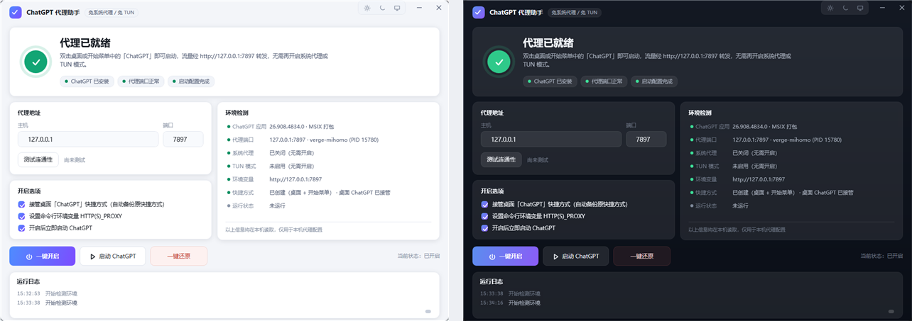
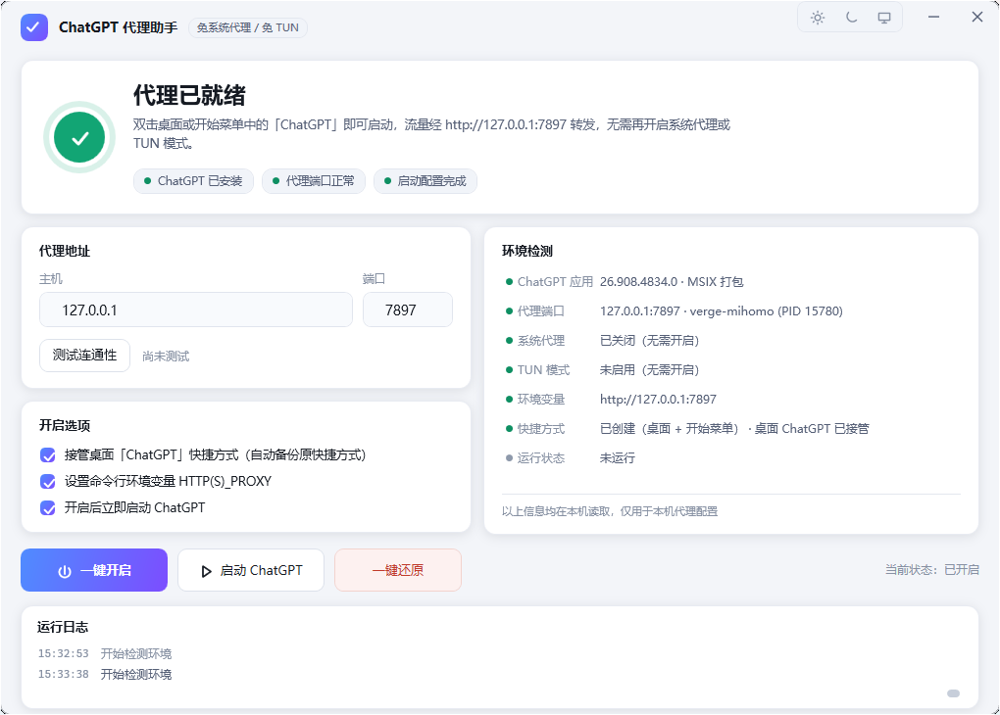
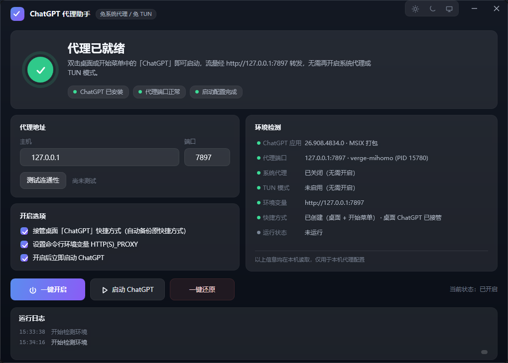
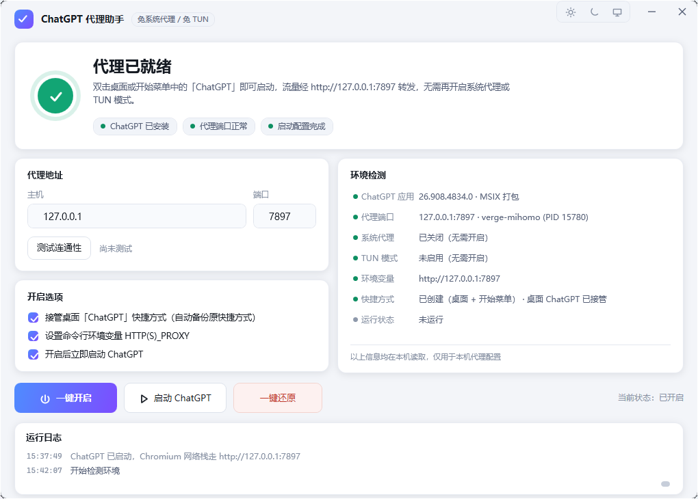

# ChatGPT 代理助手

**让 ChatGPT 桌面版直接走本地代理启动 —— 不用再开系统代理，也不用开 TUN 模式。**

一个 460 KB 的单文件 Windows 小工具，无需安装任何运行时，界面支持浅色 / 深色 / 跟随系统。

[](../../releases/latest)
[](#系统要求)
[](#系统要求)
[](LICENSE)



---

## 痛点

在国内网络环境下，ChatGPT 桌面版**必须能连上 `chatgpt.com` 才能正常启动**，否则界面会一直停在启动画面转圈。于是每次用它之前，都得先做一件事：

- 打开 Clash Verge 之类的客户端，**打开「系统代理」** —— 但这是全局设置，公司内网、VPN、其它软件的流量会一起被带走，经常造成"别的软件连不上"；
- 或者打开 **TUN 模式** —— 需要管理员权限、安装虚拟网卡，还常与 VPN、Docker、Hyper-V 的虚拟网络打架；
- 而且这两个开关**用完就忘**：忘了开，ChatGPT 打不开；忘了关，其它软件出问题。

一句话：**为了一个应用，把整个系统的网络都改了。**

## 为什么不能"只给它设个环境变量"

ChatGPT 桌面版是 MSIX 打包应用（包名 `OpenAI.Codex`），内部同时存在**两套网络栈**：

| 组件 | 走什么网络 | 认什么代理配置 |
| --- | --- | --- |
| Chromium / Electron 外壳（界面） | Chromium 网络栈 | **只认系统代理或启动参数 `--proxy-server`**，不认 `HTTP_PROXY` 环境变量 |
| Rust / Node 组件（模型与会话请求） | 各自的 HTTP 客户端 | 认 `HTTP_PROXY` / `HTTPS_PROXY` 环境变量 |

实测结论：只设环境变量时，Rust 侧能成功取到模型列表，但**界面依然卡在启动画面**——因为 Chromium 那半套还在直连外网。

而 MSIX 打包应用的快捷方式**不允许附加启动参数**。这就是"必须去开系统代理 / TUN"的根本原因。

## 解决思路

1. **带参数启动打包应用**：绕过快捷方式的限制，直接调用 COM 激活接口
   `IApplicationActivationManager::ActivateApplication`，把 `--proxy-server=http://127.0.0.1:7897`
   交给 Chromium。这样保留了应用标识，登录、通知、自动更新都不受影响。
2. **环境变量补齐另一半**：同时写入用户级 `HTTP_PROXY` / `HTTPS_PROXY` / `ALL_PROXY` / `NO_PROXY`，
   覆盖内部的 Rust / Node 组件。
3. **把启动器伪装成快捷方式**：所有「ChatGPT」快捷方式都指向本程序，程序带 `--launch` 参数静默完成
   上面的启动动作 —— 于是"双击 ChatGPT"就等于"带代理启动 ChatGPT"。
4. **做成可逆的 GUI**：自动检测环境、一键开启、一键还原、代理地址可改、内置真实连通性测试，
   所有改动都有还原路径。

### 与其它方案对比

| 方案 | 影响范围 | 需要管理员 | 需要驱动/服务 | 日常成本 |
| --- | --- | --- | --- | --- |
| 系统代理 | **全局**（所有软件） | 否 | 否 | 每次手动开关 |
| TUN 模式 | **全局**（网络层） | 是 | 是（虚拟网卡） | 每次手动开关，易与 VPN/虚拟机冲突 |
| Proxifier 等进程代理 | 指定进程 | 是 | 是（网络过滤驱动） | 需维护规则 |
| **本工具** | **只影响 ChatGPT** | 否 | 否 | 配置一次，之后正常双击快捷方式 |

## 特性

| 特性 | 说明 |
| --- | --- |
| 🚀 **一键开启** | 写入环境变量、创建「ChatGPT（本地代理）」快捷方式、接管桌面原快捷方式并（按需）立即启动 ChatGPT —— 配置动作 1 秒内完成，加上应用启动一般 2~3 秒 |
| ♻️ **一键还原** | 移除环境变量、删除本程序创建的快捷方式、恢复原始「ChatGPT」快捷方式 —— 系统回到未安装本工具前的状态 |
| 🔍 **环境检测** | 7 项实时探测：ChatGPT 版本与安装方式、代理端口被哪个进程监听、系统代理、TUN、环境变量、快捷方式、应用运行状态 |
| 🌐 **代理地址可改 + 真实连通性测试** | 主机/端口可编辑并记忆；「测试连通性」不是简单探测端口，而是用 HTTP `CONNECT` 真实打通道 `chatgpt.com:443` |
| 🎨 **三档主题** | 浅色（默认）/ 深色 / 跟随系统；选择会被记住，跟随系统时能在系统切换深浅色时即时跟随 |
| 🖥️ **原生质感界面** | 无边框窗口 + Windows 11 Mica 材质 + 自绘标题栏/图标，浅色画布统一、卡片带柔和投影 |
| 📜 **运行日志** | 每一步操作都有记录，可一键复制，保留历史（`manager.log`），排查问题不用猜 |
| ⌨️ **命令行开关** | `--launch` / `--enable` / `--restore` / `--test` / `--detect`，方便脚本化或在其它工具里调用 |
| 🪶 **零依赖单文件** | 约 460 KB，一个 exe；用 Windows 自带的 csc 编译，不需要 .NET SDK、Python 或任何第三方库 |
| 🔄 **不怕应用升级** | 动态解析 MSIX 包标识与安装路径，ChatGPT 从商店更新后无需任何调整 |

## 截图

**浅色主题（默认）**



**深色主题**



**跟随系统**



## 快速开始

1. 到 [Releases](../../releases/latest) 下载 `ChatGPTProxyManager.exe`（单文件，免安装）；
2. 双击运行，确认代理地址（默认 `127.0.0.1:7897`，Clash Verge / mihomo 的常用混合端口），
   点「**测试连通性**」确认显示"可用"；
3. 点「**一键开启**」。桌面会出现「ChatGPT（本地代理）」，原有的「ChatGPT」快捷方式也会指向本程序
   （原快捷方式自动备份）；
4. 以后直接双击桌面的 **ChatGPT** 即可，**不需要开系统代理或 TUN**。

> 首次运行 Windows SmartScreen 可能提示"未知发布者"（本程序未做代码签名）：
> 点「更多信息」→「仍要运行」即可；介意的话可以按下方说明自行从源码构建。

### 系统要求

- Windows 10 19041+ 或 Windows 11（x64）
- .NET Framework 4.8 —— Windows 10 1903 之后与 Windows 11 **系统自带**，无需另外安装
- 一个正在运行的本地代理客户端（Clash Verge / mihomo / sing-box / v2rayN 等，占一个本地 HTTP 混合端口即可）
- 已安装 ChatGPT 桌面版（Microsoft Store 的 MSIX 应用，包名 `OpenAI.Codex`）

### 卸载 / 还原

先在程序里点「**一键还原**」（移除环境变量、删掉创建的快捷方式、恢复原始快捷方式），
然后删除 `%LOCALAPPDATA%\ChatGPTProxyManager` 目录即可。本程序不写注册表服务、不装驱动，也不改动你的代理客户端配置。

## 常见问题

**Q：必须用 Clash Verge 吗？**
不必须。任何在本机监听 HTTP 混合端口的代理都能用，在界面上改「代理地址」即可（例如 `127.0.0.1:7890`）。

**Q：开启后 git / npm 之类也会走代理，正常吗？**
这是刻意的：环境变量本来就是给命令行工具用的。不想要的话，在「开启选项」里取消勾选
「设置命令行环境变量 HTTP(S)_PROXY」再点一键开启即可，ChatGPT 本身仍然走代理（靠启动参数）。

**Q：任务栏上固定的 ChatGPT 图标还是打不开？**
任务栏固定项指向的是原应用本身（Windows 不允许程序改写它），建议取消固定后，改为固定
「ChatGPT（本地代理）」这个快捷方式。

**Q：程序会碰我的代理客户端配置吗？**
不会。它只写用户级环境变量和创建快捷方式；系统代理/TUN 始终是关闭状态（检测面板里能直接看到）。

**Q：ChatGPT 从商店更新后要重新配置吗？**
不需要。程序每次启动都会动态解析包标识与安装路径。

**Q：这是什么黑科技吗？安全吗？**
全部逻辑都在本仓库里，只有一个可执行文件、没有驱动、没有服务：写用户级环境变量、创建/恢复快捷方式、
用系统 COM 接口启动应用。你可以在「运行日志」里看到它做的每一件事。

## 命令行

所有开关都是无界面执行，结果写入 `%LOCALAPPDATA%\ChatGPTProxyManager\manager.log`：

```powershell
ChatGPTProxyManager.exe --detect     # 输出环境检测结果
ChatGPTProxyManager.exe --test       # 测试代理连通性（退出码 0 = 通过，2 = 未通过）
ChatGPTProxyManager.exe --enable     # 一键开启
ChatGPTProxyManager.exe --restore    # 一键还原
ChatGPTProxyManager.exe --launch     # 静默带代理启动 ChatGPT（快捷方式使用）
```

## 工作原理（给好奇的人）

```
ChatGPTProxyManager.exe
├── 检测   读取 MSIX 包仓库注册表 → 包标识 / 版本 / 安装路径（无需 PowerShell、无需管理员）
│          读 netstat 得到端口占用进程、读注册表得到系统代理、枚举网卡判断 TUN 状态
├── 开启   写 HKCU\Environment 环境变量 + 广播 WM_SETTINGCHANGE
│          用 WScript.Shell 创建/接管快捷方式，指向本程序 --launch
│          用 IApplicationActivationManager 带 --proxy-server 启动打包应用
├── 挂载   启动后把窗口还原并置前（处理应用最小化/托盘态）
└── 还原   逐项撤销：仅移除"值等于本程序设置"的环境变量，避免覆盖用户自己的配置
```

- 技术栈：C# 5 + WPF（XAML 运行时由 `XamlReader` 载入）+ 系统自带 `csc.exe` 编译，**零第三方依赖**
- 主题：两套调色板字典（`src/ThemeLight.xaml` / `src/ThemeDark.xaml`）+ `DynamicResource`，
  切换时替换合并字典即可瞬时生效，不需要重建控件
- 窗口：`WindowChrome` 无边框 + Win11 Mica + 自绘标题栏；浅色主题用统一的不透明画布，
  层次完全交给卡片投影与发丝描边（这也是踩坑后的选择，见 `dev/README.md` 备注）

## 项目结构 & 构建

```
src/
  Core.cs            检测、环境变量、快捷方式、COM 激活、代理测试、开启/还原、主题管理
  MainWindow.cs      界面控制（事件绑定、状态刷新、主题切换、动画）
  MainWindow.xaml    界面样式与布局（运行时加载）
  ThemeLight.xaml    浅色调色板        ThemeDark.xaml   深色调色板
  Program.cs         入口与命令行开关
  app.manifest       逐显示器 DPI 感知、Win10/11 兼容声明
build/
  build.ps1          一键编译（自动把源码转 UTF-8 BOM、缺图标时自动生成）
  install.ps1        安装到 %LOCALAPPDATA%
  make-icon.ps1      生成多尺寸 .ico 图标
dev/                 开发期辅助脚本（截图/像素抽查/模拟点击等），见 dev/README.md
docs/                README 使用的截图
```

构建（Windows 自带 csc，无需安装 .NET SDK）：

```powershell
powershell -ExecutionPolicy Bypass -File build\build.ps1     # 输出 dist\ChatGPTProxyManager.exe
powershell -ExecutionPolicy Bypass -File build\install.ps1   # 安装到 %LOCALAPPDATA% 并复制说明
```

## 适用范围与已知限制

- 本工具针对 **ChatGPT 桌面版（MSIX 包 `OpenAI.Codex`）**；同一个"带参数启动"的思路也可移植到其它
  MSIX 打包的 Electron 应用，需要改一下包名匹配规则。
- 需要代理客户端保持运行；端口未监听时程序会明确提示，而不是让 ChatGPT 卡住。
- exe 未做代码签名，首次运行会触发 SmartScreen 提示。
- 本项目与 OpenAI 无任何关联，仅使用其公开安装的桌面应用。
- 开发与验证环境：Windows 11（build 26200）+ Clash Verge Rev（mihomo，混合端口 7897）+
  ChatGPT 桌面版 26.908.4834；其它代理客户端/版本理论同理，欢迎反馈。

## English TL;DR

A single-file Windows utility (~460 KB, no runtime to install) that makes the **ChatGPT desktop app**
launch through your local proxy (`127.0.0.1:7897` by default) **without enabling the Windows system proxy
or TUN mode**. The app is an MSIX package with two network stacks: its Chromium shell only honours the
system proxy or a `--proxy-server` launch switch, and MSIX shortcuts cannot carry arguments — so setting
`HTTP_PROXY` alone still leaves the UI stuck on the splash screen. This tool activates the packaged app
through `IApplicationActivationManager` with `--proxy-server`, sets the user-level proxy env vars for the
bundled Rust/Node parts, and repoints your ChatGPT shortcuts at itself, so a normal double-click launches
it proxied. It ships with environment detection, a real proxy connectivity test (HTTP CONNECT to
`chatgpt.com:443`), one-click enable/restore (fully reversible), and light/dark/follow-system themes.

## 许可

[MIT](LICENSE)
