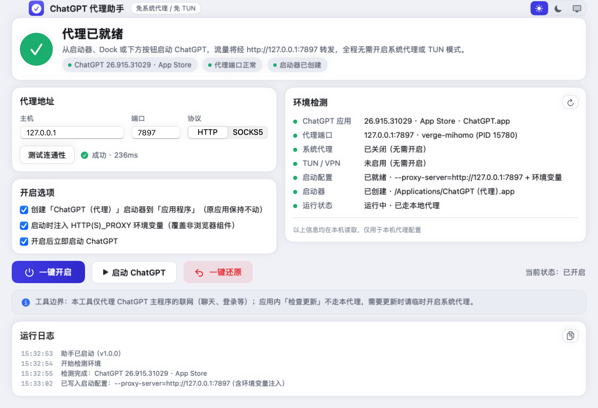
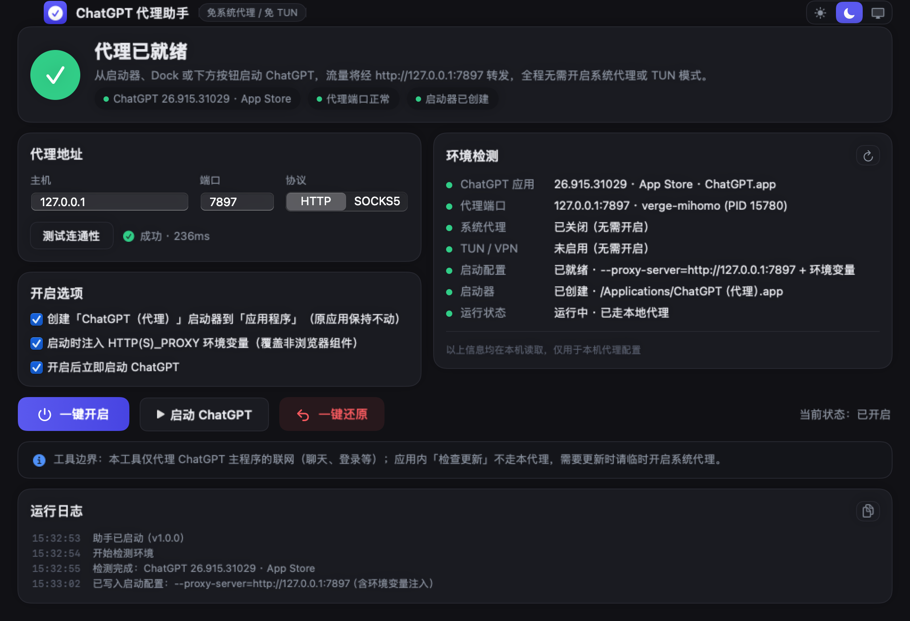

# ChatGPT 代理助手 for macOS

**让 ChatGPT 桌面版（macOS）走本地代理启动 —— 无需系统代理，也无需 TUN 虚拟网卡。**

与仓库内 [Windows 版](../README.md)（C# / WPF）痛点一致、界面风格一致，实现原理按 macOS 重新研究。
SwiftUI 原生应用，零第三方依赖，`swift build` 即可编译。



## 实现原理（与 Windows 不同）

本机实测确认：macOS 版 ChatGPT（bundle id `com.openai.codex`）与 Windows 版同源，
**内核同样是 Chromium**（`Codex Framework`，内嵌版本号即 Chromium 版本）。Chromium 只认
系统代理或 `--proxy-server` 启动参数，而 macOS 的 `open` 命令原生支持透传参数与环境变量：

```bash
# Chromium 外壳的全部流量走本地代理
open /Applications/ChatGPT.app --args --proxy-server=http://127.0.0.1:7897

# 可选：注入环境变量，覆盖应用内非浏览器组件（旧系统 open 不支持 --env 时自动回退为直接拉起主程序注入）
open /Applications/ChatGPT.app --env HTTPS_PROXY=http://127.0.0.1:7897 --args --proxy-server=http://127.0.0.1:7897
```

- 不修改系统代理（`scutil` / `networksetup` 完全不动）、不创建 TUN 网卡、不装任何内核扩展；
- 可创建「ChatGPT（代理）」启动器到「应用程序」（复用 ChatGPT 官方图标），双击即得以代理方式启动，原应用零改动；
- 一键还原：移除启动器与配置即可，全程可逆。

## 功能

- 🚀 一键开启 / 一键还原，完整可逆
- 🔍 环境检测 7 项：ChatGPT 应用（版本 · 安装方式）、代理端口（监听进程 + PID，兼容 root 特权服务）、系统代理、TUN/VPN、启动配置、启动器、运行状态（是否已走代理 / 是否走了其它代理）
- 🌐 代理地址可改（主机 / 端口 / HTTP 或 SOCKS5）+ 真实连通性测试（经代理请求 `chatgpt.com:443`）
- 🎨 三档主题：浅色（默认）/ 深色 / 跟随系统
- 📜 运行日志（`manager.log`），一键复制
- ⌨️ 命令行开关：`--detect` / `--test` / `--enable` / `--launch` / `--restore`



## 使用

1. 本机需已运行代理客户端（Clash Verge / mihomo / sing-box / Surge 等的本地混合端口）；
2. 打开「ChatGPT 代理助手」，确认代理地址（首次运行会自动探测常见端口，如 7897）；
3. 点「测试连通性」确认能打通 `chatgpt.com:443`；
4. 点「一键开启」——默认会创建启动器并立即以代理方式启动 ChatGPT；
5. 之后从启动器 / Dock / 助手按钮启动 ChatGPT 即可。

### 命令行

```bash
./ChatGPTProxyHelper --detect            # 环境检测
./ChatGPTProxyHelper --test --port 7897  # 连通性测试（退出码 0 = 通过）
./ChatGPTProxyHelper --enable            # 写配置 + 建启动器（+ 启动）
./ChatGPTProxyHelper --launch            # 按当前配置带代理启动
./ChatGPTProxyHelper --restore           # 一键还原
```

配置与日志位于 `~/Library/Application Support/ChatGPTProxyHelper/`。

## 构建

```bash
scripts/build-app.sh            # 产物：build/ChatGPT 代理助手.app
```

要求：macOS 13+，Xcode Command Line Tools（Swift 5.9+）。

## 已知限制

- ChatGPT 的 **「检查更新」** 由应用内置的 Sparkle 框架走系统网络（URLSession），既不认
  `--proxy-server` 也不认环境变量 —— 需要更新 ChatGPT 时请**临时开启系统代理**，更新完成后再关闭；
  助手界面的「工具边界」提示会说明这一点。
- 发布包未做代码签名 / 公证，首次打开若提示"无法验证开发者"，在终端执行
  `xattr -cr "/Applications/ChatGPT 代理助手.app"` 放行即可。
- ChatGPT 语音通话走 UDP，HTTP 代理转发不了 UDP，此类流量走不通是代理协议本身限制。
- 本项目与 OpenAI 无任何关联，仅使用其公开安装的桌面应用。MIT 许可，见[仓库根目录](../LICENSE)。
